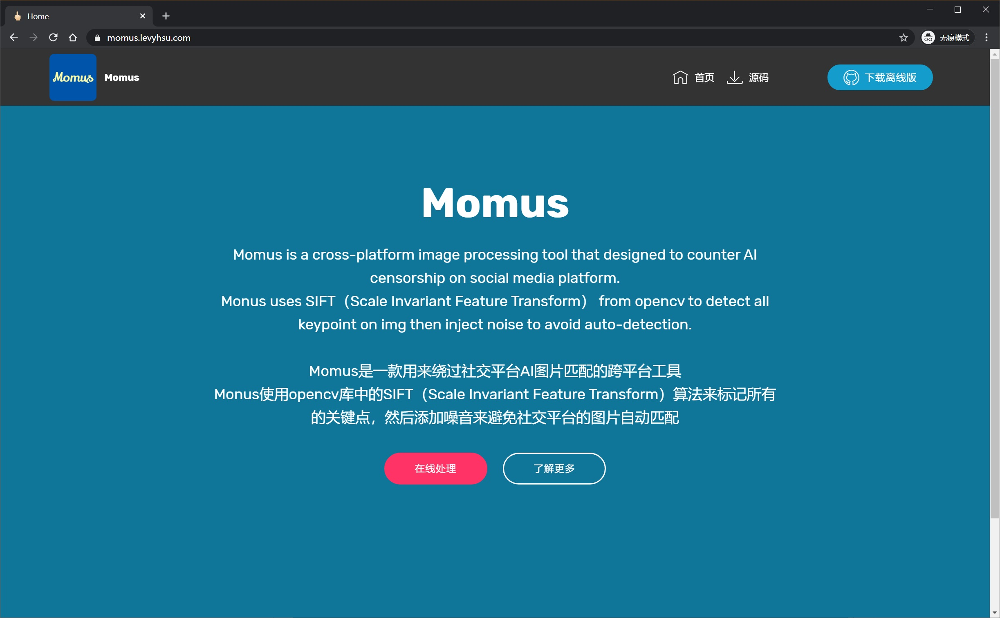

# Momus

SIFT-based image obfuscation tool to reduce perceptual matching and automated similarity detection on social platforms. Provides an offline desktop GUI and an online Flask demo.

中文简介：Momus 是一款通过在关键点附近注入扰动、添加噪声与随机形状、随机裁剪等方式来降低社交平台图片相似度匹配的跨平台图像处理工具（支持本地 GUI 与在线演示）。

## Overview

Momus leverages OpenCV’s SIFT (Scale-Invariant Feature Transform) to detect keypoints in an image, then perturbs pixels around those keypoints and applies additional randomized transformations to decrease similarity scores used by automated matching systems.

- SIFT keypoint detection (OpenCV contrib)
- Keypoint-local pixel approximation (“blur” at features)
- Salt-and-pepper noise around detected features
- Random lines/rectangles overlay
- Random edge cropping (avoids exact size matches)
- Visual progress with side-by-side comparisons and kNN match visualization (offline GUI)

Use responsibly. This project is distributed under GPL-3.0; see LICENSE.

## Contents

- Features
- How It Works
- Requirements
- Quick Start (Offline GUI)
- Quick Start (Flask Demo)
- Packaging (Windows EXE)
- Output Files
- Screenshots / Demos
- Troubleshooting
- License and Acknowledgements

## Features

- Offline desktop GUI (PySimpleGUI)
- Online Flask demo (upload/process/download)
- Auto and manual modes for control over perturbation strength
- Side-by-side original vs processed previews
- Keypoint visualization and kNN matching preview to tune results

## How It Works

- Detects SIFT keypoints with `cv2.xfeatures2d.SIFT_create()`.
- Applies several perturbations, focusing near feature points:
  - Keypoint-local pixel approximation (`keypoint_obscure`) replaces pixels with nearby values.
  - Salt-and-pepper noise (`keypoint_white_black_salt`) injects white/black pixels.
  - Random shapes (`Random_Shape_Draw`) draws random lines/rectangles.
  - Random cropping (`Random_Crop`) trims edges to avoid exact dimension matches.
- Visualizes progress every iteration via three views: original vs processed, processed with keypoints, and kNN match comparison.

Code references:
- Offline GUI workflow: `Momus.py`
- Core image operations: `image_processing.py`
- Flask app demo: `Momus_flask.py`

## Requirements

- Python 3.7+ recommended
- OS: Windows / Linux (macOS may require additional Tkinter setup for PySimpleGUI)
- Dependencies (see `requirements.txt`):
  - `opencv-contrib-python==3.4.2.16` (required for SIFT via `xfeatures2d`)
  - `PySimpleGUI`, `numpy`, `matplotlib`, `pillow`, `flask`

Note: SIFT is provided via OpenCV contrib. If you encounter `AttributeError: module 'cv2.cv2' has no attribute 'xfeatures2d'`, ensure `opencv-contrib-python` is installed and not being shadowed by a different OpenCV package.

## Quick Start (Offline GUI)

Install dependencies:
```bash
pip3 install -r requirements.txt
```

Run the GUI:
```bash
python3 Momus.py
```

What you’ll see:
- Main checkbox: 反SIFT (anti-SIFT matching) — the primary processing mode
- Tabs: 自动 (Auto) and 手动 (Manual)
  - Auto: set Target Similarity and let Momus iterate until it drops below that threshold
  - Manual: tune per-step parameters and iteration count
    - Pixel Approximation 密度
    - Salt-and-pepper Noise 密度
    - Random Shape 密度
    - Random Crop 裁剪像素
    - 迭代次数 (more iterations = stronger effect with smaller per-iteration changes)

During processing, the GUI cycles through:
- Original vs Processed comparison
- Processed with SIFT keypoints
- kNN match visualization (number of “good” matches)

## Quick Start (Flask Demo)

Run the server locally:
```bash
python3 Momus_flask.py
```
Then open:
```
http://localhost:5000/
```

Upload a PNG/JPG/JPEG and choose a processing strength. The server enforces a 20MB max file size; images over 2MB are resized/compressed automatically.

Levels map to increasing perturbation passes:
- high: lighter processing
- mid/low/superlow: progressively stronger processing (more iterations, more noise/shapes)

Note: The online demo writes temporary files under `templates/usr_temp_files` and serves assets from `templates/`.

## Packaging (Windows EXE)

Build a single-file EXE with PyInstaller:
```bash
pyinstaller -F -i logo.ico -w Momus.py -p image_processing.py
```

You may want to run this inside a clean virtual environment with dependencies pinned to those in `requirements.txt`.

## Output Files

- Offline GUI: `originalname_output.png` (same directory as the input)
- Flask demo: `originalname_output.jpg` (saved under `templates/usr_temp_files/`)

## Screenshots / Demos

- Online demo screenshot:



- Offline GUI (v1.2):


- Offline GUI (v1.4):


- Counter OCR demo:


## Troubleshooting

- SIFT not found / `xfeatures2d` missing:
  - Ensure `opencv-contrib-python==3.4.2.16` is installed.
  - Avoid mixing multiple OpenCV wheels in the same environment.
- macOS Tkinter issues (PySimpleGUI backend):
  - Some macOS versions require additional Tk installs or differ in default Tcl/Tk provided by the system. If the GUI fails to start, verify your Python’s Tk support or try another OS.
- Large files in Flask mode:
  - Files > 20MB are rejected; files between 2MB and 20MB are resized/compressed.

## License

GPL-3.0 — see `LICENSE`.

## Acknowledgements

Select references and resources that informed the implementation and UI:
- https://docs.opencv.org/3.4/d2/d29/classcv_1_1KeyPoint.html
- https://docs.opencv.org/3.4/dc/dc3/tutorial_py_matcher.html
- https://opencv-python-tutroals.readthedocs.io/en/latest/py_tutorials/py_feature2d/py_matcher/py_matcher.html
- https://github.com/PySimpleGUI/PySimpleGUI
- https://pythonise.com/categories/javascript/upload-progress-bar-xmlhttprequest
